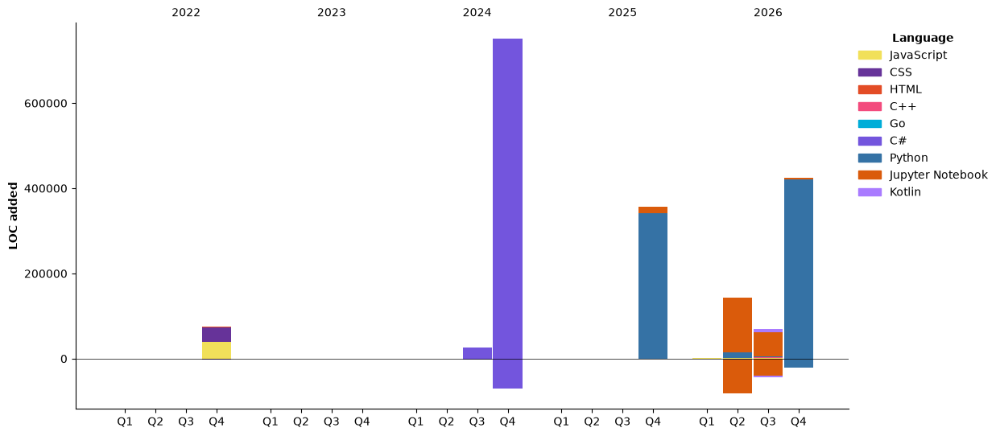

### Hi there 👋 This is 加乘 
<!--
<p align="center">
  
</p>
-->
<picture>
  <source media="(prefers-color-scheme: dark)" srcset="https://raw.githubusercontent.com/40436michael/40436michael/output/github-snake-dark.svg" />
  <source media="(prefers-color-scheme: light)" srcset="https://raw.githubusercontent.com/40436michael/40436michael/output/github-snake.svg" />
  
</picture>

<!--START_SECTION:waka-->


**I'm a Night 🦉** 

```text
🌞 Morning                197 commits         ██░░░░░░░░░░░░░░░░░░░░░░░   09.08 % 
🌆 Daytime                748 commits         █████████░░░░░░░░░░░░░░░░   34.47 % 
🌃 Evening                808 commits         █████████░░░░░░░░░░░░░░░░   37.24 % 
🌙 Night                  417 commits         █████░░░░░░░░░░░░░░░░░░░░   19.22 % 
```
📅 **I'm Most Productive on Friday** 

```text
Monday                   341 commits         ████░░░░░░░░░░░░░░░░░░░░░   15.71 % 
Tuesday                  327 commits         ████░░░░░░░░░░░░░░░░░░░░░   15.07 % 
Wednesday                273 commits         ███░░░░░░░░░░░░░░░░░░░░░░   12.58 % 
Thursday                 209 commits         ██░░░░░░░░░░░░░░░░░░░░░░░   09.63 % 
Friday                   532 commits         ██████░░░░░░░░░░░░░░░░░░░   24.52 % 
Saturday                 338 commits         ████░░░░░░░░░░░░░░░░░░░░░   15.58 % 
Sunday                   150 commits         ██░░░░░░░░░░░░░░░░░░░░░░░   06.91 % 
```


📊 **This Week I Spent My Time On** 

```text
🕑︎ Time Zone: Asia/Taipei

💬 Programming Languages: 
Python                   10 hrs 54 mins      █████████████░░░░░░░░░░░░   50.12 % 
Markdown                 7 hrs 12 mins       ████████░░░░░░░░░░░░░░░░░   33.12 % 
Text                     54 mins             █░░░░░░░░░░░░░░░░░░░░░░░░   04.21 % 
Bash                     53 mins             █░░░░░░░░░░░░░░░░░░░░░░░░   04.14 % 
Other                    37 mins             █░░░░░░░░░░░░░░░░░░░░░░░░   02.90 % 

🔥 Editors: 
Claude Code              21 hrs 13 mins      ████████████████████████░   97.60 % 
VS Code                  31 mins             █░░░░░░░░░░░░░░░░░░░░░░░░   02.40 % 

💻 Operating System: 
Windows                  21 hrs 45 mins      █████████████████████████   100.00 % 
```

🤖 **AI Coding This Week** 

```text
⏱ AI Coding Time: 21 hrs 26 mins (98.58%)

✍️ 12,872 lines written by AI, 13 lines written by hand (99.9% AI-written)

🔤 12,554,058 Input Tokens, 2,537,773 Output Tokens

💵 $220.56 Estimated AI Cost This Week

🧠 14 AI Sessions, 151 AI Prompts

Opus                     13,162 lines        █████████████████████████   99.29 % 
Sonnet                   94 lines            ░░░░░░░░░░░░░░░░░░░░░░░░░   00.71 % 
Haiku                    0 lines             ░░░░░░░░░░░░░░░░░░░░░░░░░   00.00 % 

🔎 AI Coding Insights:
🤖 AI-Driven — 99.9% of written lines came from AI
📚 Verbose Prompter — average 2,157 characters per prompt
🔁 Iterative Prompter — average 11 prompts per session
🚀 High AI Trust — 0.12% of changed lines were hand-edited
```

**Timeline**




 Last Updated on 04/11/2026 04:00:03 UTC
<!--END_SECTION:waka-->


<!--


[](https://github.com/anuraghazra/github-readme-stats) 
-->

<p align="center"></p>

<p align="center"></p>

<p align="center"></p>
<!--
<p align="center">
  
</p>
-->
<!--
**40436michael/40436michael** is a ✨ _special_ ✨ repository because its `README.md` (this file) appears on your GitHub profile.

Here are some ideas to get you started:

- 🔭 I’m currently working on ...
- 🌱 I’m currently learning ...
- 👯 I’m looking to collaborate on ...
- 🤔 I’m looking for help with ...
- 💬 Ask me about ...
- 📫 How to reach me: ...
- 😄 Pronouns: ...
- ⚡ Fun fact: ...
-->
