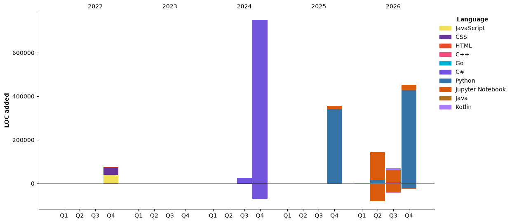

### Hi there 👋 This is Chia-Cheng Chueh (add mul)
<!--
<p align="center">
  
</p>
-->
<picture>
  <source media="(prefers-color-scheme: dark)" srcset="https://raw.githubusercontent.com/40436michael/40436michael/output/github-snake-dark.svg" />
  <source media="(prefers-color-scheme: light)" srcset="https://raw.githubusercontent.com/40436michael/40436michael/output/github-snake.svg" />
  
</picture>

<!--START_SECTION:waka-->


**I'm a Night 🦉** 

```text
🌞 Morning                214 commits         ██░░░░░░░░░░░░░░░░░░░░░░░   09.29 % 
🌆 Daytime                776 commits         ████████░░░░░░░░░░░░░░░░░   33.70 % 
🌃 Evening                857 commits         █████████░░░░░░░░░░░░░░░░   37.21 % 
🌙 Night                  456 commits         █████░░░░░░░░░░░░░░░░░░░░   19.80 % 
```
📅 **I'm Most Productive on Friday** 

```text
Monday                   362 commits         ████░░░░░░░░░░░░░░░░░░░░░   15.72 % 
Tuesday                  367 commits         ████░░░░░░░░░░░░░░░░░░░░░   15.94 % 
Wednesday                294 commits         ███░░░░░░░░░░░░░░░░░░░░░░   12.77 % 
Thursday                 226 commits         ██░░░░░░░░░░░░░░░░░░░░░░░   09.81 % 
Friday                   547 commits         ██████░░░░░░░░░░░░░░░░░░░   23.75 % 
Saturday                 351 commits         ████░░░░░░░░░░░░░░░░░░░░░   15.24 % 
Sunday                   156 commits         ██░░░░░░░░░░░░░░░░░░░░░░░   06.77 % 
```


📊 **This Week I Spent My Time On** 

```text
🕑︎ Time Zone: Asia/Taipei

💬 Programming Languages: 
Markdown                 12 hrs 46 mins      ██████████░░░░░░░░░░░░░░░   39.24 % 
Python                   10 hrs 16 mins      ████████░░░░░░░░░░░░░░░░░   31.53 % 
Other                    5 hrs 40 mins       ████░░░░░░░░░░░░░░░░░░░░░   17.44 % 
C++                      1 hr 45 mins        █░░░░░░░░░░░░░░░░░░░░░░░░   05.40 % 
Java                     53 mins             █░░░░░░░░░░░░░░░░░░░░░░░░   02.73 % 

🔥 Editors: 
Claude Code              30 hrs 30 mins      ███████████████████████░░   93.67 % 
VS Code                  2 hrs 3 mins        ██░░░░░░░░░░░░░░░░░░░░░░░   06.33 % 

💻 Operating System: 
Windows                  20 hrs 50 mins      ████████████████░░░░░░░░░   64.01 % 
Linux                    11 hrs 43 mins      █████████░░░░░░░░░░░░░░░░   35.99 % 
```

🤖 **AI Coding This Week** 

```text
⏱ AI Coding Time: 30 hrs 45 mins (94.46%)

✍️ 11,860 lines written by AI, 80 lines written by hand (99.33% AI-written)

🔤 15,005,693 Input Tokens, 2,233,159 Output Tokens

💵 $238.99 Estimated AI Cost This Week

🧠 31 AI Sessions, 309 AI Prompts

Opus                     8,685 lines         ██████████████████░░░░░░░   72.21 % 
Fable                    3,342 lines         ███████░░░░░░░░░░░░░░░░░░   27.79 % 
Haiku                    0 lines             ░░░░░░░░░░░░░░░░░░░░░░░░░   00.00 % 

🔎 AI Coding Insights:
🤖 AI-Driven — 99.33% of written lines came from AI
📄 Detailed Prompter — average 747 characters per prompt
🔁 Iterative Prompter — average 10 prompts per session
🚀 High AI Trust — 0.94% of changed lines were hand-edited
```

**Timeline**




 Last Updated on 18/11/2026 05:15:06 UTC
<!--END_SECTION:waka-->


<!--


[](https://github.com/anuraghazra/github-readme-stats) 
-->

<p align="center"></p>

<p align="center"></p>

<p align="center"></p>
<!--
<p align="center">
  
</p>
-->
<!--
**40436michael/40436michael** is a ✨ _special_ ✨ repository because its `README.md` (this file) appears on your GitHub profile.

Here are some ideas to get you started:

- 🔭 I’m currently working on ...
- 🌱 I’m currently learning ...
- 👯 I’m looking to collaborate on ...
- 🤔 I’m looking for help with ...
- 💬 Ask me about ...
- 📫 How to reach me: ...
- 😄 Pronouns: ...
- ⚡ Fun fact: ...
-->
